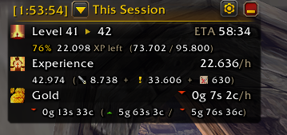

# NodoTracker

[](../../releases/latest)
[](LICENSE)


XP and gold tracker for **WoW Forever** (Interface 16001), styled like Blizzard's built-in damage meter.



- **This Session / Overall** via the yellow dropdown (Overall is kept until you reset it)
- Level progress with XP left and ETA
- Experience per hour, split into kills, quests and other (exploration)
- Gold per hour, net total, income and spending
- Settings in *Options → AddOns → NodoTracker* (font, sizes, width, scale, background)

## Install

**Release zip:** download `NodoTracker-x.y.z.zip` from the [latest release](../../releases/latest) and extract it into
`World of Warcraft\_forever_\Interface\AddOns\`.

**Git:** clone straight into the AddOns folder. The folder must be named `NodoTracker`
(WoW only loads an addon whose folder name matches its `.toc`):

```
cd "World of Warcraft\_forever_\Interface\AddOns"
git clone https://github.com/schweigerchristian/wow-forever-nodotracker.git NodoTracker
```

Update later with `git pull` inside that folder.

**WowUp:** *Get Addons → Install from URL* with the repository URL.

## Commands

| Command | Action |
| --- | --- |
| `/ntr` | Show / hide the window |
| `/ntr reset` | Start a new session |
| `/ntr config` | Open the settings |
| `/ntr debug` | Print how each XP gain is classified |

## Notes

On 12.x-based clients addons cannot use the combat log. Kills are detected via the
client's own (localized) XP chat message, quests via `QUEST_TURNED_IN`.

## Bugs and feedback

Please open an [issue](../../issues).

## License

[MIT](LICENSE) © Christian Schweiger
